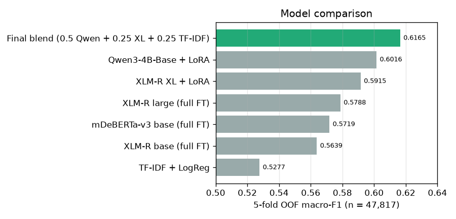
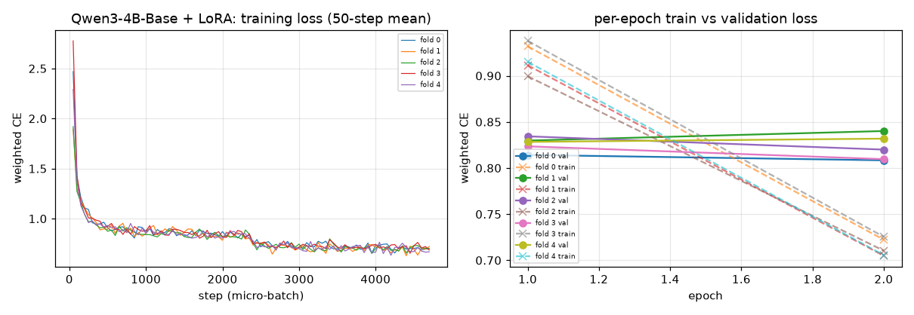
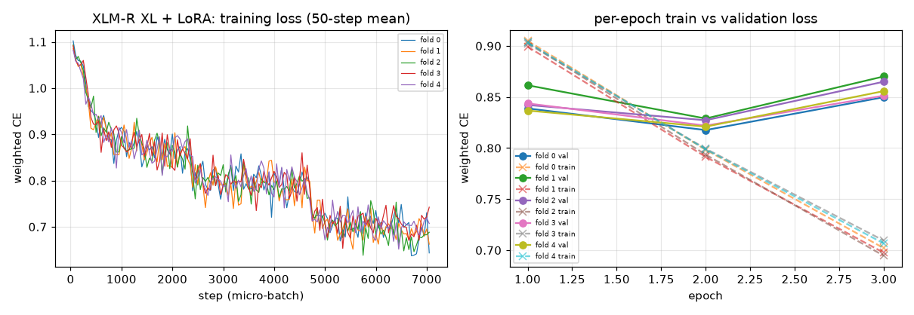
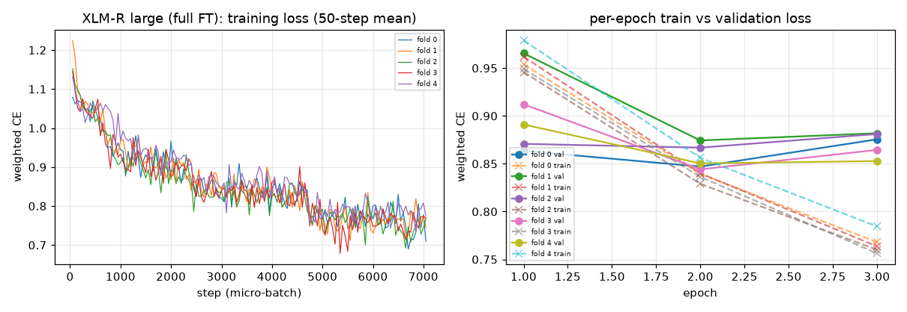
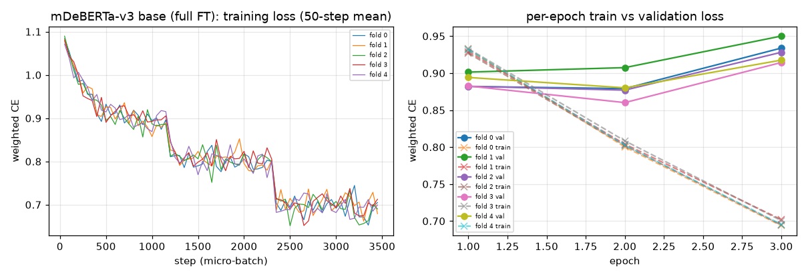
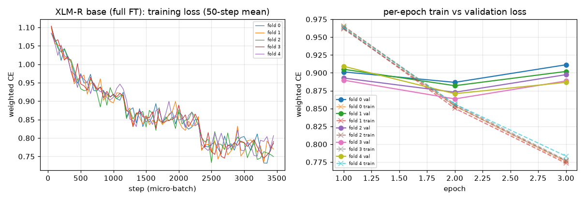

# Results summary — team ScatteredBrains

All scores are **5-fold out-of-fold (OOF) macro-F1 on the full training set (n = 47,817)**. Every model uses the same
`StratifiedKFold(5, shuffle=True, random_state=42)` split (`data/processed/folds.csv`), so the numbers are directly
comparable. The public-leaderboard scores we observed are 0.5912 (4-encoder ensemble) and 0.6097 (Qwen + XLM-R large +
TF-IDF), each within 0.004 of its OOF score. The tables are regenerated by `python scripts/make_reports.py`.

## 1. Model comparison

| Model | OOF macro-F1 | F1 explicit | F1 subtle | F1 neutral | F1 Latin | F1 Bangla | F1 mixed |
|---|---|---|---|---|---|---|---|
| TF-IDF + LogReg | 0.5277 | 0.652 | 0.504 | 0.427 | 0.544 | 0.458 | 0.462 |
| XLM-R base (full fine-tune) | 0.5639 | 0.687 | 0.505 | 0.500 | 0.589 | 0.477 | 0.487 |
| mDeBERTa-v3 base (full fine-tune) | 0.5719 | 0.692 | 0.514 | 0.509 | 0.601 | 0.482 | 0.468 |
| XLM-R large (full fine-tune) | 0.5788 | 0.704 | 0.505 | 0.527 | 0.611 | 0.476 | 0.492 |
| XLM-R XL + LoRA | 0.5915 | 0.703 | 0.530 | 0.541 | 0.625 | 0.488 | 0.514 |
| Qwen3-4B-Base + LoRA | 0.6016 | 0.708 | 0.545 | 0.551 | 0.641 | 0.487 | 0.459 |
| **Final: 0.50 Qwen + 0.25 XL + 0.25 TF-IDF** | **0.6165** | **0.717** | **0.559** | **0.573** | **0.653** | **0.502** | 0.505 |

Per-script columns are macro-F1 within each writing system. Latin is 27,604 rows, Bangla 19,382 and mixed 789 (small, so noisy).
The final blend's per-fold scores are 0.623, 0.610, 0.613, 0.618 and 0.620.

## 2. Efficiency (RTX 4090 24 GB)

| Model | Train time, 5 folds (min) | Train GPU (GB) | Inference GPU, fp16 (GB) | Parameters | Saved size | Inference posts/s |
|---|---|---|---|---|---|---|
| Qwen3-4B-Base + LoRA | 278 | ~10.0 (nvidia-smi) | 8.7 | 4.06B total / 33.0M trainable (0.8%) | 5 x 126 MB fp32 (63 MB fp16) | 120 |
| XLM-R XL + LoRA | 122 | ~18–20 (nvidia-smi) | 7.4 | 3.52B total / 39.7M trainable (1.1%) | 5 x 126 MB fp32 (63 MB fp16) | 485 |
| TF-IDF + LogReg | 2.3 (train + predict, CPU) | 0 | 0 | ≤ 800k sparse features x 3 | not saved (retrains in minutes) | – |
| XLM-R large (full fine-tune) | 50 | ~12 (nvidia-smi) | – | 560M | weights not saved | – |
| mDeBERTa-v3 base (full fine-tune) | 29 | – | – | 278M | weights not saved | – |
| XLM-R base (full fine-tune) | 22 | – | – | 278M | weights not saved | – |

* Inference posts/s comes from the fp16 notebook run (Kaggle-T4 precision) on the 4090. That run predicts 47,817 OOF + 5 x 11,955 test posts per model, and model loading is included.
* Train GPU memory was read from `nvidia-smi` during training; the training code did not log it.
* **The full final pipeline in predict mode takes 21 minutes, with a peak of 8.7 GB, so it fits a 16 GB Kaggle T4.**
* `python main.py --quick` rebuilds the submission from saved probabilities in under 1 second on CPU.

## 3. Training curves
Class-weighted cross-entropy (the same weights for train and validation), 50-step running mean, all 5 folds.

| | |
|---|---|
|  |  |
|  |  |
|  | TF-IDF + LogReg is a convex L-BFGS fit, so it has no epoch curve. |

Validation loss is flat or rising after epoch 2 for every encoder while training loss keeps falling (overfitting to label
noise). For that reason, every fold keeps the checkpoint with the best validation macro-F1.

## 4. Ablations (all run; deltas in macro-F1)

| Change | Result | Delta | Kept? |
|---|---|---|---|
| 4-encoder equal-weight ensemble vs the best single encoder (fold 0) | 0.597 vs 0.579 | **+0.018**, 95% CI [+0.010, +0.026] | yes (Submission #1) |
| Class-prior / threshold re-weighting (split-half held out) | – | −0.003 | no |
| + BanglaBERT (equal / routed to Bangla rows), fold 0 | 0.597 / 0.599 | +0.001 / +0.002, not significant | no (also CC BY-NC-SA license) |
| + MuRIL in the ensemble | – | no gain | no |
| Exact-duplicate label lookup | – | +0.000 | no |
| TF-IDF kNN label features + stacking | – | +0.001, not significant | no |
| Logistic-regression stacker instead of plain averaging | – | −0.029 | no |
| XLM-R large + label smoothing 0.1, LLRD 0.92, FGM (2 seeds) | single model 0.583 / 0.586 vs 0.578 | +0.005 / +0.008 alone, ≤ +0.003 inside the ensemble (not significant) | no |
| Qwen3-4B + LoRA alone vs the 4-encoder ensemble (5-fold) | 0.6016 vs 0.5936 | **+0.008**, CI [+0.004, +0.012] | yes |
| Qwen + 4-encoder ensemble at 1:1 vs Qwen alone | 0.6117 | **+0.010**, CI [+0.007, +0.013] | yes |
| Encoders reduced to XLM-R large + TF-IDF (Q+L+T) vs all four | 0.6131 vs 0.6117 | +0.001, not significant, and simpler | yes |
| **XLM-R XL instead of XLM-R large (Q+XL+T)** | **0.6165** vs 0.6131 | **+0.0034**, CI [+0.0012, +0.0056], better on 3 of 5 folds | **final** |
| Q+L+XL+T (both encoders) | 0.6152 | −0.001 vs final | no |
| Q+XL without TF-IDF | 0.6110 | −0.0055 vs final | no |
| fp16 instead of bf16 inference (Kaggle T4) | 0.6164 | −0.0001, and 99.82% of test labels identical | notebook uses fp16 on a T4 |

All CIs are paired bootstraps over rows. The rule "switch only if the lower CI bound is above 0" was fixed before each comparison.

## 5. Ethics and responsible use

**Per-script fairness.** The model is much weaker on Bangla (macro-F1 0.502) than on Latin-script text (0.653). The error
is not symmetric: it over-flags Bangla.

| Script | Rows | Neutral share | Neutral posts flagged as toxic | Toxic posts missed as neutral |
|---|---|---|---|---|
| Latin | 27,604 | 16.1% | 37.1% | 6.9% |
| Bangla | 19,382 | 7.4% | **70.9%** | 2.8% |
| Mixed | 789 | 2.4% | 57.9% | 1.6% |

This shows that Bangla speakers would have their harmless posts removed far more often. Part of the cause is that neutral
Bangla posts are rare in the training data (7.4%). The system should not be used to moderate Bangla content automatically.

**False positives vs false negatives.** Overall, 45.3% of neutral posts are flagged as toxic (2,673 of 5,898), while
only 5.1% of toxic posts are passed as neutral (2,128 of 41,919). The model errs toward flagging: 88% of the training
posts are toxic, so even with class-weighted loss, neutral recall is only 0.55 (precision 0.60). The largest
confusion is between explicit and subtle toxicity (5,495 explicit predicted subtle, 6,834 subtle predicted explicit). That
boundary is inherently subjective.

**Label noise.** 63 normalised texts appear with conflicting labels (167 rows; for example "Disgusting" is labelled both
0 and 1), and 669 rows are duplicates after normalisation. Because of this ambiguity, the explicit/subtle boundary cannot
be learned perfectly. We kept the labels as given and did not relabel anything by hand.

**Human-in-the-loop use.** We recommend using the probabilities for triage, not for automatic removal:
* rank posts for human moderators;
* auto-act only at very high explicit-toxicity confidence;
* always send subtle-toxicity and Bangla predictions to a human reviewer;
* audit false-positive rates per language before deployment.

**The id leak, and why it is excluded.** The `id` column follows the row order of the concatenated source corpora, so
nearby ids share a source and a label distribution. With id-neighbour features alone, a model reaches **≈ 0.594 macro-F1
without reading the text**, and text + id-neighbour features reach 0.681 OOF (`experiments/12_leak_ceiling.py`,
diagnosis only). This is not a genuine contribution: it does not transfer to new posts, and exploiting it breaks the
competition rules. No model, feature or fold assignment in this package uses `id`; it is used only as a row key for
joining and output (checked by `tests/test_submission.py::test_no_id_feature_in_model_code`). We report the leak here so
the organizers can take it into account.

**Licenses and data.** Only models with OSI-approved licenses that allow commercial use are included: Qwen3 (Apache-2.0)
and XLM-R (MIT). No external or pseudo-labelled data was used, and no competition text is included in this package.
